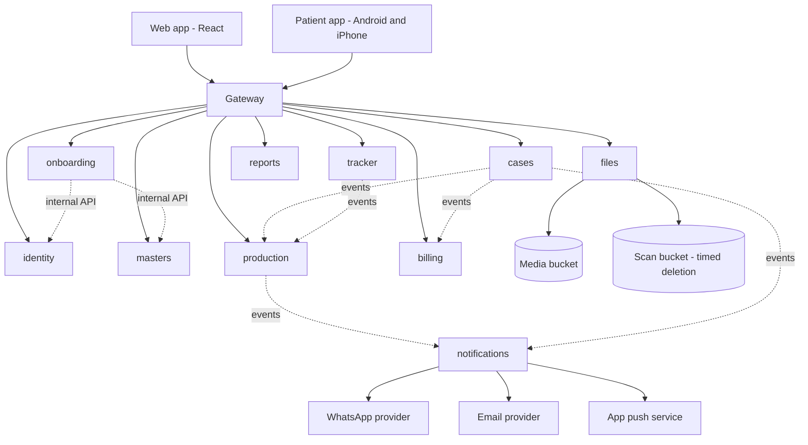

# 03 — System architecture

## 1. Principles

1. **Modular, not monolithic.** Each module is a service with its own API and its own database. No service reads another service's database. **Settled.**
2. **API first.** The web app, the patient app and other services all use the same documented HTTP APIs.
3. **Access is enforced in every service.** Each service checks the token, the permission and the scope itself. It does not trust the gateway or the client.
4. **Pick, never type.** Clinic, doctor, patient, product and machine are always chosen from records. Free text is never used as an identifier.
5. **Nothing is lost silently.** Status changes, approvals and deletions leave a record.

## 2. Stack

| Layer | Choice | Status |
|---|---|---|
| Database | MongoDB (Mongoose) | **Settled** (MERN) |
| API services | Node.js 20+, Express, plain JavaScript, ES modules | **Settled** |
| Web app | React with Vite | **Settled** |
| Patient app | React Native, one codebase for Android and iPhone | **Assumed** |
| File storage | S3-compatible object storage | **Assumed** |
| Packaging | Docker; npm workspaces in one repository | Built |

## 3. Services

In the core design, fifteen modules run as eleven services. Version 2.0 adds fifteen modules and twelve services; they are listed in section 13. Modules that always change together share a service.

| Service | Modules | Database | Status |
|---|---|---|---|
| `gateway` | Routing, rate limit | none | Built |
| `identity` | Identity and access, audit log | `avm_identity` | Built |
| `masters` | Clinics, doctors, products, price lists | `avm_masters` | Built; price lists to add |
| `onboarding` | Lead management, distributors, onboarding approval | `avm_onboarding` | Built in part; lead pipeline and two-step approval to add (sales track) |
| `integrations` | Adapters for ad platforms, LumenAI, MCube, Exotel, WhatsApp Business | `avm_integrations` | Sales track |
| `cases` | Patients, prescriptions, plans, treatment planning | `avm_cases` | Phase 2 |
| `files` | Photos, x-rays, videos, IPR, STL scans | `avm_files` | Phase 2 |
| `production` | Aligner sets, print orders, batches, QC, inventory, machines, dispatch, schedule | `avm_production` | Phase 3 |
| `tracker` | Patient check-ins, wear time, doctor decisions | `avm_tracker` | Phase 4 |
| `notifications` | Templates, sending, message log | `avm_notifications` | Phase 4 |
| `billing` | Invoices, payments | `avm_billing` | Phase 5 |
| `reports` | Read-only summaries built from the other services' APIs | `avm_reports` (cache only) | Phase 5 |



## 4. How services talk

### 4.1 From outside

Everything enters through the gateway at `/api/<service>/...`. The gateway only routes and rate-limits. Paths under `/internal` are blocked at the gateway.

### 4.2 Between services — direct calls

Used when the caller needs the answer now, for example onboarding creating a clinic in masters. The call carries a shared internal key (`x-internal-key`) and the acting user (`x-actor`) for the audit log. If a later step fails, the caller undoes the earlier steps. This is built and in use for lead approval.

### 4.3 Between services — events

Used when one service must react to something that happened in another, and the first service should not wait or fail because of it.

| Event | Raised by | Reacts |
|---|---|---|
| `lead.received` | integrations | onboarding (create or update the lead) |
| `lead.qualified` | integrations (from LumenAI) | onboarding (score, stage), notifications (to the BDE) |
| `call.completed`, `message.received` | integrations | onboarding (activity on the lead) |
| `lead.assigned`, `followup.due` | onboarding | notifications |
| `patient.created` | cases | notifications (app invite), identity (patient login) |
| `plan.approved` | cases | production (create aligner sets), billing (create invoice), notifications |
| `plan.superseded` | cases | production (close remaining sets) |
| `sets.dispatched` | production | notifications |
| `box.received` | production | notifications |
| `order.due` | production | notifications (to manufacturing team) |
| `checkin.created` | tracker | production (move schedule), notifications (to dentist) |
| `checkin.decided` | tracker | production (hold or release), cases (rescan), notifications |
| `scan.expiring` | files | notifications |
| `stock.low` | production | notifications |
| `invoice.created`, `payment.recorded` | billing | notifications |

**Recommended design (assumed):** each service writes the event to an `outbox` collection in its own database in the same operation as the change. A small worker in that service delivers events to the receiving services' `/internal/events` endpoint and retries until accepted. Receivers store the event id and ignore repeats. This avoids a message broker in the first version and still loses nothing if a service is down. A broker can replace the worker later without changing the events.

There are no database transactions across services.

## 5. Sign-in and tokens

- Staff, partners and dentists: email and password. Patients: mobile number and a one-time code delivered by WhatsApp, with email as the fallback. **Assumed**, because SMS is not a chosen channel.
- Sign-in returns an access token (15 minutes) and a refresh token (7 days for web, 60 days for the patient app; single use; stored hashed).
- The access token carries role, level, permissions and scope ids. Every service verifies it with the shared secret.
- Passwords are hashed with bcrypt. Five wrong attempts lock the account for 15 minutes.
- For production, move token signing from a shared secret to a key pair, so that only identity can issue tokens and the other services can only verify. **Recommended.**

## 6. File storage

Two buckets.

| Bucket | Holds | Rule |
|---|---|---|
| Media | Photos, x-rays, videos, IPR files, setup files, check-in photos, onboarding documents | Standard storage, kept |
| Scans | STL files only | Day 30: move to low-cost class. Day 180: delete. **Settled** |

How it works:

1. The client asks the `files` service for an upload link. The service checks access and returns a short-lived signed link.
2. The client uploads straight to the bucket.
3. The client confirms. The service records size, checksum, uploader and, for a scan, `expiresOn` = upload date + 180 days.
4. Downloads work the same way: access check, then a short-lived signed link.
5. The move and the deletion are **bucket lifecycle rules**, not application code. They run even if the portal is down.
6. A daily job in `files` marks records whose file has gone as deleted, and raises `scan.expiring` 14 days ahead.
7. A hold is set on the object itself, so the lifecycle rule cannot delete it.

Choosing the low-cost class: pick one whose minimum storage period is shorter than 150 days, because a scan sits in it from day 30 to day 180. On Google Cloud that is Coldline (90-day minimum); Archive (365-day minimum) would cost more. On another provider, check the equivalent minimum-duration charge before setting the rule.

## 7. Hosting

**Settled:** a paid cloud with servers in India. The provider is **open**.

| Part | Needs |
|---|---|
| Services | Container hosting with at least two instances of each service in production |
| Database | Managed MongoDB replica set in an India region, automatic daily backups, point-in-time recovery |
| Storage | S3-compatible buckets in an India region with lifecycle rules and object holds |
| Secrets | A secrets manager. No secrets in the repository or in images |
| Network | HTTPS everywhere; database and internal ports not reachable from the internet |
| Environments | Local (Docker Compose, built), staging, production |

Local Docker Compose is for development and demos with sample data only. **Settled.**

## 8. Patient app

- One React Native codebase for Android and iPhone. **Assumed.**
- Uses the same APIs through the gateway.
- Push notifications through the platforms' own services.
- The app stores the refresh token in the phone's secure storage.
- Store listings under the name AVMAligners. Publishing needs a Google Play developer account and an Apple developer account in the company's name. **Open: who creates these.**

## 9. Notifications

- WhatsApp through the WhatsApp Business connection held by the `integrations` service, using approved templates.
- Email through a transactional email provider.
- App notifications through the push services.
- The `notifications` service decides what to send and to whom. For WhatsApp it hands the message to `integrations`; for email and app alerts it talks to the provider itself. Other services only raise events.

## 10. Integrations

One service, `integrations`, is the only part of the system that talks to outside partners for leads, calls and WhatsApp.

| Partner | Direction | What flows |
|---|---|---|
| Meta, Google, Bing, TikTok lead forms; website forms | In | New leads with source, campaign and ad details |
| LumenAI | Both | Out: a new lead to qualify, a follow-up to make. In: score, outcome, call and WhatsApp summaries, transcripts, recording links |
| MCube, Exotel | Both | Out: a call request from the lead screen. In: call records with duration, outcome and recording link |
| WhatsApp Business | Both | Out: template messages. In: replies and delivery status |

Design rules:

1. **One adapter per partner.** An adapter turns the partner's format into the portal's own events and back. Replacing a partner means replacing one adapter.
2. **Either side.** Telephony and WhatsApp may be connected directly, or through LumenAI. A setting per channel says which. The rest of the portal sees the same events either way. **Open: which side.**
3. **Nothing is lost.** Every incoming item is stored as received before it is processed, has its signature checked, is processed once, and can be replayed.
4. **Least access.** Each partner has its own key. A partner can reach only its own endpoint and cannot read portal data beyond what that endpoint returns.
5. **No clinical data.** Integrations carry lead and contact data only. Patient records never go to an ad platform, a calling tool or LumenAI.

## 11. Repository layout

```
apps/web                 React web app
apps/patient             React Native patient app          (phase 4)
gateway                  API gateway
packages/common          shared: auth, permissions, errors, audit, events
services/identity        built
services/masters         built
services/onboarding      built
services/cases           phase 2
services/files           phase 2
services/production      phase 3
services/tracker         phase 4
services/notifications   phase 4
services/billing         phase 5
services/reports         phase 5
services/integrations    sales track
docs/handover            these documents
scripts/e2e.mjs          end-to-end checks
```

## 12. Rules for every new service

1. Own database. No reads from another service's database.
2. Every route: authenticate → permission → scope in the query. Out-of-scope returns 404.
3. Every request body validated.
4. Every create, update, approval and status change audited.
5. New permissions added to `packages/common/src/permissions.js`.
6. End-to-end checks added, including one "another user cannot see this" check per record type.

<!--EXT2-->
## 13. Services added in version 2.0

The rules of section 12 apply to each: its own database, its own API, events through the outbox, scope in every query.

| Module | Service | Database | Phase |
|---|---|---|---|
| Partner management | partners | `avm_partners` | 6 |
| White-label branding | branding | `avm_branding` | 6 |
| Store and asset library | store | `avm_store` | 6 |
| Support desk and complaints | support | `avm_support` | 6 |
| Finance extensions | billing (extended) | `avm_billing` | 6 |
| Marketing automation | marketing | `avm_marketing` | 7 |
| Calling workspace and AI playbooks | onboarding and integrations (extended) | `avm_onboarding, avm_integrations` | 7 |
| Sales performance | sales | `avm_sales` | 7 |
| Clinical extensions | clinical; cases and files (extended) | `avm_clinical` | 8 |
| Patient engagement | tracker (extended) | `avm_tracker` | 8 |
| Logistics | logistics | `avm_logistics` | 8 |
| Manufacturing execution and quality system | production (extended); quality | `avm_production, avm_quality` | 9 |
| Purchasing and costing | purchasing | `avm_purchasing` | 9 |
| Learning and knowledge | learning | `avm_learning` | 9 |
| Platform, privacy and management insight | identity (extended); insight | `avm_identity, avm_insight` | 10 |

Twelve services are new (partners, branding, store, support, marketing, sales, clinical, logistics, quality, purchasing, learning, insight), making 23. Six existing services are extended with new collections and endpoints: billing, onboarding, integrations, tracker, production and identity.

### New partner connections

Each is one adapter in the integrations service, behind the same interface as the existing ones.

| Partner | Direction | Used by |
|---|---|---|
| Payment partner | Out: payment session. In: signed payment event | Finance extensions |
| E-invoice and e-way bill provider | Out: invoice. In: reference number and QR | Finance extensions |
| Courier partner | Out: booking. In: tracking and proof of delivery | Logistics |
| Scanner clouds | In: scans | Clinical extensions |
| E-sign provider | Out: agreement. In: signed event | Sales performance |
| Ad platforms, conversions and audiences | Out: events and hashed lists | Marketing automation |
| Patient finance partner | Out: offer. In: approval | Finance extensions |
| Accounting software | Out: export file | Finance extensions |
| Printers | In: job status | Manufacturing execution |
| Single sign-on provider | In: sign-in | Platform |

### Events added

`store.ordered`, `ticket.opened`, `ticket.breached`, `payment.received`, `credit.hold_on`, `credit.hold_off`, `brand.live`, `artwork.approved`, `shipment.booked`, `shipment.delivered`, `shipment.at_risk`, `replacement.requested`, `set.station_scanned`, `nc.opened`, `recall.started`, `stock.low` (now also read by purchasing), `lead.stage_changed` (now also read by marketing), `rating.low`, `agreement.signed`, `course.passed`.
