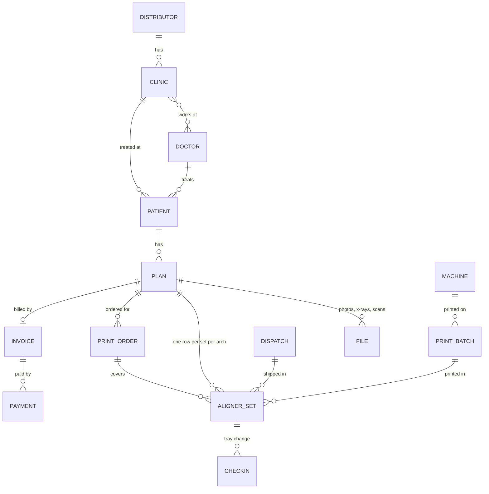

# 04 — Data model

Each service owns its database. A field that points to a record in another service holds that record's id as a string. Where a service needs another service's data for display or filtering, it keeps a small copy (marked *copy*); the owning service stays the source of truth.

Every collection also has `createdAt`, `updatedAt` and `createdBy`. Ids are MongoDB ObjectIds. Dates are stored in UTC and shown as DD-MM-YYYY.

Req: `Y` required, blank optional.

## Overview

---

## 1. identity — `avm_identity`

### users (built; fields marked new to add)

| Field | Type | Req | Notes |
|---|---|---|---|
| name | string | Y | |
| email | string | | Unique, lower case. Required for all except patients |
| phone | string | | Required and unique for patients (new rule) |
| passwordHash | string | | Not used for patients |
| role | string | Y | Role key |
| status | `active` \| `disabled` | Y | |
| mustChangePassword | boolean | | |
| distributorId | string | | Scope |
| doctorId | string | | Scope. For clinic staff, the dentist they work for |
| patientId | string | | Scope. **New** |
| failedLogins, lockedUntil, lastLoginAt | | | |

### roles (built)

| Field | Type | Req | Notes |
|---|---|---|---|
| key | string | Y | Unique |
| name | string | Y | |
| level | number | Y | |
| permissions | string[] | | `*` for Super Admin |

### refresh_tokens (built)
`userId`, `tokenHash` (unique), `expiresAt`, `revokedAt`, `device` (new: web or app).

### otp_codes (new)
`phone` or `email`, `codeHash`, `expiresAt` (5 minutes), `attempts` (max 5), `usedAt`.

### audit_logs (built, append-only)
`at`, `service`, `action`, `entity`, `entityId`, `actorId`, `actorEmail`, `actorRole`, `ip`, `details`.

### settings (new)
One document per key. `key`, `value`, `updatedBy`. Keys include `leadTimeDays` (print, courier, buffer), `scanRetentionDays` (180), `scanColdAfterDays` (30), `stalledAfterDays` (180), tax settings. Changing needs `settings:update`.

---

## 2. masters — `avm_masters`

### clinics (built; billing fields new)

| Field | Type | Req | Notes |
|---|---|---|---|
| name | string | Y | |
| type | `avmsmiles` \| `external` | Y | |
| address, city, state, pincode, phone | string | city Y | |
| labShortName | string | | Manufacturing team's short code |
| shipToAddress | string | | |
| status | `active` \| `inactive` | Y | |
| distributorId | string | | Empty = direct clinic, billed by the company |
| brandingDefault | `branded` \| `white_label` | Y | **New.** Default supply type for new plans of this clinic. Copied from the distributor when the clinic is created |
| ownerUserId | string | | Who onboarded it |
| billingName, billingAddress, gstin | string | | **New.** Used on invoices for direct clinics |

### doctors (built)
`name` Y, `email`, `phone`, `licenseNo`, `userId`, `clinicIds[]`, `status`, `distributorId`, `ownerUserId`.

### products (built)
`code` Y unique, `name` Y, `description`, `active`. Add `hsnCode` and `taxRatePercent` for invoicing (new, **assumed** — confirm with Accounts).

### price_lists (new)

| Field | Type | Req | Notes |
|---|---|---|---|
| name | string | Y | |
| appliesTo | `direct` \| `distributor_default` \| `distributor` | Y | |
| distributorId | string | | Required when `appliesTo` = `distributor` |
| branding | `branded` \| `white_label` | Y | One list per supply type |
| effectiveFrom | date | Y | A new list is added for a price change; old ones are kept |
| items | array | Y | `{ productCode, price }` — price per case, before tax (**assumed**: pricing is per case by product) |

The price for an invoice is taken from the list for the plan's `branding` with the latest `effectiveFrom` on or before the plan approval date: the distributor's own list if it has one, else the distributor default; the direct list for direct clinics.

---

## 3. onboarding — `avm_onboarding`

### distributors (built; billing fields new)
`code` Y unique, `name` Y, `contactName`, `email`, `phone`, `states[]`, `cities[]`, `status`, plus new `billingName`, `billingAddress`, `gstin`, and `brandingDefault` (`branded` \| `white_label`), the default for the distributor's clinics.

### leads (built in part; pipeline fields new)

| Field | Type | Req | Notes |
|---|---|---|---|
| leadType | `dentist` \| `clinic` \| `distributor` | Y | **New** |
| contactName, email, phone | string | Y | Built as `dentistName`; rename |
| licenseNo | string | | Dentists |
| organisationName, city | string | Y | Clinic or distributor name. Built as `clinicName` |
| address, state, pincode | string | | |
| clinicType | `avmsmiles` \| `external` | | |
| territory | object | | Distributor leads: `{ states[], cities[] }` |
| stage | see below | Y | Replaces `status` |
| lostReason | string | | Required when stage is `lost` |
| sourceId, campaignId | string | | **New** |
| tracking | object | | **New.** `{ utmSource, utmMedium, utmCampaign, adId, formId, keyword, landingPage }` |
| touches | array | | **New.** One per repeat enquiry: `{ at, sourceId, campaignId }` |
| score, qualification | number, object | | **New.** From LumenAI: `{ outcome, summary, at }` |
| assignedTo, assignedName | string | | Current owner |
| accountId | string | | Direct sales account |
| distributorId | string | | Set when a distributor refers the lead |
| nextFollowUpAt | date | | |
| doNotContact | object | | `{ calls, whatsapp, at, by }` |
| documentFileIds | string[] | | Licence, registration, GST certificate |
| review | object | | `{ by, byName, at }` — Sales head |
| decision | object | | `{ by, byName, at, reason }` |
| result | object | | `{ clinicId, doctorId, distributorId, userId }` |

Stage: `new` → `qualified` → `contacted` → `with_sales` → `won` → `in_review` → `approved` → `onboarded`. `lost` from any stage; a lost lead can be re-opened.

### lead_activities (new, append-only)

| Field | Type | Req | Notes |
|---|---|---|---|
| leadId | string | Y | |
| type | `call` \| `whatsapp` \| `visit` \| `note` \| `stage_change` \| `assignment` \| `email` | Y | |
| by | string | Y | User id, or `lumenai` |
| at | date | Y | |
| summary | string | | |
| call | object | | `{ direction, number, durationSec, outcome, recordingUrl, provider }` |
| visit | object | | `{ metWith, outcome, nextStep }` |
| transcript | string | | For LumenAI calls and WhatsApp conversations |

### accounts (new)
`name` Y, `ownerUserId` Y (direct sales), `type` (chain, group practice, institution), `city`, `notes`, `status`.

### sources and campaigns (new)
`sources`: `code` Y unique (meta, google, bing, tiktok, website, reengagement, lumenai, referral, other), `name`.
`campaigns`: `sourceId` Y, `name` Y, `externalId` (the platform's campaign id), `startOn`, `endOn`, `status`.

### spend_entries (new)
`sourceId` Y, `campaignId`, `month` Y, `amount` Y (whole rupees), `enteredBy`, `origin` (`manual` or `pulled`).

### assignment_rules (new)
`mode` (`territory`, `rotation`, `manual`) Y, `leadType`, `states[]`, `cities[]`, `assignToUserIds[]`, `active`.

---

## 4. cases — `avm_cases`

### patients

| Field | Type | Req | Notes |
|---|---|---|---|
| patientCode | string | Y | Unique, generated, e.g. `AVM-000123`. Printed on boxes |
| firstName, lastName | string | Y | |
| mobile | string | Y | The patient's, or the guardian's for a minor |
| email | string | | |
| gender | `male` \| `female` \| `other` | Y | |
| dateOfBirth | date | Y | |
| guardianName, guardianMobile | string | | Required when under 18 |
| doctorId | string | Y | From the signed-in dentist. Never typed |
| clinicId | string | Y | Picked from the dentist's clinics |
| distributorId | string | | *copy* from the clinic, for billing |
| clinicCaseNo | string | | The clinic's own reference. Optional, never used to link anything |
| userId | string | | Patient login, once created |
| consent | object | | `{ acceptedAt, version, acceptedBy }` — by the patient or guardian in the app |
| legacyRef | string | | Old-portal patient code, if this patient started there |
| status | `active` \| `completed` \| `inactive` | Y | |

### plans

| Field | Type | Req | Notes |
|---|---|---|---|
| patientId | string | Y | |
| planNo | number | Y | 1, 2, 3 per patient |
| type | `initial` \| `refinement` \| `rescan` | Y | |
| status | see below | Y | |
| productCode | string | Y | |
| branding | `branded` \| `white_label` | Y | From the clinic's `brandingDefault`; the dentist can change it until approval, then it is fixed |
| conditions | string[] | | From a fixed list of 16 |
| conditionNotes | string | | |
| prescription | object | Y | See below |
| toothInstructions | array | | `{ tooth, type }` — tooth is FDI number 11–48; type is `do_not_move`, `avoid_attachment`, `will_extract`, `leave_space` |
| expectedUpper, expectedLower | number | Y | Dentist's estimate |
| setups | array | | One per revision. See below |
| finalUpper, finalLower | number | | From the approved setup |
| retainerIncluded | boolean | | From the approved setup |
| requiresIPR | boolean | | |
| approvedAt, approvedBy | | | |
| supersededByPlanId | string | | |

Status: `draft` → `submitted` → `setup_uploaded` → `approved` → `completed`. `revision_requested` loops back to `setup_uploaded`. `superseded` and `cancelled` end a plan early.

`prescription`: `chiefComplaint`, `upperMidline` and `lowerMidline` (`{ position: centered|right|left, mm }`), `canine` and `molar` (`{ right, left }` class), `overbite`, `overjetMm`, `endon`, `instructions` (for each of upper midline, lower midline, overjet, overbite, arch form, canine, molar, posterior crossbite: `maintain` \| `improve` \| `idealize`), `ipr`, `attachments`, `procline`, `expand`, `distalize` (each `yes` \| `no` \| `only_if_needed`), `additionalInstructions`.

`setups[]`: `version`, `setupFileId`, `iprFileId`, `upper`, `lower`, `retainerIncluded`, `notes`, `uploadedBy`, `uploadedAt`, `decision` (`{ result: approved|rejected, by, at, reason }`).

---

## 5. files — `avm_files`

### files

| Field | Type | Req | Notes |
|---|---|---|---|
| kind | `photo` \| `xray` \| `video` \| `ipr` \| `setup` \| `scan` \| `checkin` \| `document` | Y | |
| slot | string | | Photos: `frontal_repose`, `frontal_smiling`, `profile_repose`, `profile_other`, `buccal_right`, `buccal_left`, `buccal_front`, `occlusal_upper`, `occlusal_lower`, `extra`. X-rays: `panoramic`, `lateral_ceph`. Scans: `upper`, `lower`, `bite` |
| planId, patientId | string | | Empty for onboarding documents |
| doctorId, clinicId | string | | *copy*, for scope |
| leadId | string | | For onboarding documents |
| bucket | `media` \| `scans` | Y | |
| key | string | Y | Path in the bucket. Never shown to users |
| contentType, sizeBytes, checksum | | Y | |
| version | number | Y | Per plan and slot. A new upload is a new version |
| status | `pending` \| `stored` \| `deleted` | Y | |
| uploadedBy, uploadedAt | | Y | |
| expiresOn | date | | Scans only: upload date + 180 days |
| onHold | boolean | | Scans only |
| holdBy, holdReason, holdAt | | | |
| deletedOn | date | | Set when the file has gone. The row is kept |

---

## 6. production — `avm_production`

### plan_states
One per approved plan. Created from the `plan.approved` event.

| Field | Type | Req | Notes |
|---|---|---|---|
| planId | string | Y | Unique |
| patientId, patientCode, patientName | string | Y | *copy* |
| clinicId, doctorId, productCode, branding | string | Y | *copy*. `branding` decides tray marking, packaging and label |
| daysPerSet | number | Y | Default from settings; dentist or manufacturing team can change |
| treatmentStartDate | date | | Date the patient starts set 1. Entered by the clinic |
| setsPerBox | number | Y | Set by the manufacturing team |
| onHold | boolean | | True after a doctor's hold decision |
| status | `active` \| `completed` \| `superseded` | Y | |

### aligner_sets

| Field | Type | Req | Notes |
|---|---|---|---|
| planId | string | Y | |
| setNo | number | Y | 1, 2, 3 … |
| arch | `upper` \| `lower` | Y | |
| setType | `aligner` \| `retainer` \| `template` | Y | |
| status | see below | Y | |
| orderId, batchId, dispatchId | string | | Current ones |
| dueToStartOn | date | | From the schedule |
| startedOn | date | | From a confirmed tray change |

Unique on (`planId`, `setNo`, `arch`, `setType`).
Status: `planned` → `ordered` → `printed` → `qc_passed` → `dispatched` → `received`. `rejected` returns to `ordered`. `superseded`, `cancelled`.

### print_orders
`orderNo` (generated), `planId` Y, `arches` (`upper`, `lower`, `both`) Y, `fromSet` Y, `toSet` Y, `includeRetainer`, `urgent`, `neededBy`, `raisedBy` Y, `raisedOn` Y, `status` (`open`, `printed`, `cancelled`), `notes`.

### print_batches
`batchNo` (generated), `printedOn` Y, `machineId` Y, `printedBy` Y, `modelCount` Y, `setIds[]` Y, `materialsUsed` (`[{ itemId, quantity }]`), `qc` (`{ result: passed|rejected|partial, by, at, notes }`).

### dispatches
`dispatchNo` (generated), `planId` Y, `clinicId` Y, `setIds[]` Y, `boxNo` (1, 2, 3 per plan), `courier`, `trackingNo`, `branding` (*copy*; `white_label` prints the plain label), `dispatchedBy` Y, `dispatchedOn` Y, `receivedOn`, `receivedBy`, `runsOutOn`, `orderByOn`.

### set_events (append-only)
`setId` Y, `event` (`created`, `ordered`, `printed`, `qc_passed`, `rejected`, `dispatched`, `received`, `started`, `superseded`, `cancelled`), `reason`, `byUser`, `at`.

### items (raw materials)
`code` Y unique, `name` Y, `unit` Y (kg, litre, sheet, piece), `currentStock` Y, `reorderLevel` Y, `active`.

### stock_movements (append-only)
`itemId` Y, `type` (`receipt`, `issue`, `adjustment`, `wastage`) Y, `quantity` Y (signed), `batchId`, `reference` (supplier bill or note), `byUser` Y, `at` Y, `balanceAfter` Y.

### machines
`code` Y unique, `name` Y, `type` (printer, thermoformer, trimmer, other), `model`, `serialNo`, `installedOn`, `status` (`running`, `down`, `retired`), `dailyCapacityModels`.

### machine_logs
`machineId` Y, `type` (`maintenance`, `downtime`) Y, `from` Y, `to`, `reason`, `doneBy`, `notes`.

---

## 7. tracker — `avm_tracker`

### checkins
`patientId` Y, `planId` Y, `setNo` Y, `changedOn` Y, `recordedBy` (`patient` or `clinic`) Y, `photoFileIds[]`, `note`, `decision` (`{ result: continue|hold|rescan, by, at, note }`).

### wear_logs
`patientId` Y, `planId` Y, `date` Y, `hoursWorn` Y. Unique on (`patientId`, `date`).

---

## 8. notifications — `avm_notifications`

### templates
`event` Y, `channel` (`whatsapp`, `email`, `push`) Y, `audience` Y, `subject`, `body` (with placeholders), `providerTemplateId` (WhatsApp), `enabled`.

### messages (append-only)
`event`, `channel`, `toUserId`, `to` (number, address or device), `status` (`queued`, `sent`, `delivered`, `failed`), `error`, `sentAt`, `relatedEntity`, `relatedId`.

### device_tokens
`userId` Y, `platform` (`android`, `ios`) Y, `token` Y, `lastSeenAt`.

---

## 9. billing — `avm_billing`

### invoices

| Field | Type | Req | Notes |
|---|---|---|---|
| invoiceNo | string | Y | Unique, generated in sequence per financial year |
| customerType | `distributor` \| `clinic` | Y | Distributor when the clinic belongs to one |
| customerId | string | Y | |
| customerName, billingAddress, gstin | string | Y | *copy* at the time of invoicing |
| planId, patientCode | string | Y | Patient name is **not** stored on the invoice |
| branding | `branded` \| `white_label` | Y | *copy* from the plan; decides the price list used |
| lines | array | Y | `{ productCode, description, hsnCode, quantity, unitPrice, taxRatePercent, taxAmount, amount }` |
| subtotal, taxTotal, total | number | Y | Whole rupees |
| amountPaid, balance | number | Y | |
| status | `unpaid` \| `part_paid` \| `paid` \| `cancelled` | Y | |
| issuedOn | date | Y | |
| dueOn | date | | |
| cancelledBy, cancelReason | | | An invoice is cancelled, never deleted |

### payments
`invoiceId` Y, `amount` Y, `receivedOn` Y, `mode` (`bank_transfer`, `upi`, `cheque`, `cash`, `gateway`) Y, `reference`, `recordedBy` Y, `gatewayRef` (for later).

---

## 10. integrations — `avm_integrations`

### connections
`partner` Y unique (meta, google, bing, tiktok, website, lumenai, mcube, exotel, whatsapp), `status` (`active`, `paused`, `error`), `side` (`portal` or `lumenai`, for telephony and WhatsApp), `lastEventAt`, `lastError`, `settings` (non-secret only; secrets stay in the secrets manager).

### inbound_events (append-only)
`partner` Y, `externalId` (the partner's own id, used to ignore repeats), `receivedAt` Y, `signatureValid` Y, `raw` Y (as received), `status` (`received`, `processed`, `failed`, `ignored`), `error`, `resultEvent` (the portal event it produced).

### outbound_requests
`partner` Y, `type` (`qualify_lead`, `call`, `whatsapp_template`), `payload` Y, `status` (`queued`, `sent`, `failed`), `attempts`, `lastError`, `relatedLeadId`.

---

## 11. In every service

### outbox
`eventId` Y unique, `type` Y, `payload` Y, `createdAt`, `deliveredTo[]`, `attempts`, `lastError`.

### processed_events
`eventId` Y unique, `receivedAt`. Lets a receiver ignore a repeat.

---

## 12. Indexes that matter

| Collection | Index | Why |
|---|---|---|
| leads | `phone`, `email`, `stage` + `assignedTo`, `sourceId` + `campaignId`, `nextFollowUpAt` | Duplicate check, queues, source reports |
| inbound_events | `partner` + `externalId` unique | Process once |
| patients | `doctorId`, `clinicId`, `patientCode` unique, `mobile` | Scope and search |
| plans | `patientId` + `planNo` unique, `status` | |
| files | `planId` + `slot` + `version`, `expiresOn` + `status` | Expiry list |
| aligner_sets | `planId` + `setNo` + `arch` + `setType` unique, `status`, `clinicId` (*copy*, add for reports) | Clinic-wise counts |
| print_orders | `status` + `neededBy` | Print queue |
| dispatches | `planId`, `orderByOn` | Due-to-order list |
| invoices | `customerType` + `customerId`, `status`, `planId` unique | One invoice per plan |

<!--EXT2-->
## 13. Collections added in version 2.0

Every collection also has `createdAt`, `updatedAt`, `createdBy` and, where it belongs to an account, the owning `distributorId` or `clinicId` for scope. Copies of names follow the same rule as before: copied at the time, marked *copy*.

### Partner management — `avm_partners`

| Collection | Main fields |
|---|---|
| partner_users | `distributorId`, `userId`, `partnerRole` (owner, sales, accounts, support), `areas[]` |
| schemes | `name`, `period`, `slabs[] {from, to, discountPercent, benefit}`, `appliesTo` |
| scheme_progress | `distributorId`, `schemeId`, `cases`, `slabReached`, `creditNoteId` |
| territories | `distributorId`, `states[]`, `cities[]`, `pincodes[]`, `exclusive` |
| territory_alerts | `distributorId`, `leadId or clinicId`, `channel`, `resolvedAs` |
| announcements | `title`, `body`, `audience`, `ackRequiredBy`, `acks[] {userId, at}` |
| business_reviews | `distributorId`, `quarter`, `figures`, `notes`, `agreedActions[]` |
| provider_levels | `doctorId`, `level`, `cases12m`, `validUntil` |
| partner_prices | `distributorId`, `productCode`, `sellingPrice`, `effectiveFrom` (visible to that distributor only) |

### White-label branding — `avm_branding`

| Collection | Main fields |
|---|---|
| brand_profiles | `distributorId`, `brandName`, `appName`, `logoFileId`, `colours`, `portalDomain`, `senderName`, `supportPhone`, `productNames{}`, `appliedTo{}`, `status` (draft, in_review, live) |
| artworks | `brandProfileId`, `item` (box, pouch, insert, tray_mark, label), `fileId`, `version`, `partnerDecision`, `companyDecision`, `regulatoryChecked` |
| partner_packaging_stock | `brandProfileId`, `item`, `stock`, `reorderLevel`, `minimumOrder`, `lastPrintedOn` |
| partner_invoices | `distributorId`, `doctorId`, `planId`, `patientCode`, `lines[]`, `total`, `status` |
| ndas | `distributorId or clinicId`, `agreementId`, `signedOn` |

### Store and asset library — `avm_store`

| Collection | Main fields |
|---|---|
| store_items | `code`, `name`, `category`, `unit`, `prices{direct, distributor}`, `visibleTo[]`, `active` |
| store_orders | `orderNo`, `customerType`, `customerId`, `lines[]`, `shipTo`, `status`, `dispatchId`, `invoiceId` |
| kits | `kitNo`, `contents`, `issuedTo`, `heldAt`, `returnBy`, `status` |
| assets | `title`, `type`, `audience[]`, `languages[]`, `fileId`, `version`, `approvedBy`, `status`, `downloads` |

### Support desk and complaints — `avm_support`

| Collection | Main fields |
|---|---|
| tickets | `ticketNo`, `raisedBy`, `raisedFor` (patient code, clinic, distributor), `channel`, `type`, `subject`, `ownerTeam`, `ownerUserId`, `dueAt`, `status`, `links{planId, dispatchId, ncId}`, `satisfaction` |
| ticket_messages | `ticketId`, `from`, `text`, `fileIds[]`, `internal` |
| sla_rules | `type`, `firstReplyMinutes`, `resolveHours`, `escalateTo` |

### Finance extensions — `avm_billing`

| Collection | Main fields |
|---|---|
| credit_accounts | `customerType`, `customerId`, `limit`, `creditDays`, `onHold`, `holdReason`, `releasedBy` |
| online_payments | `gatewayRef`, `payer`, `mode`, `amount`, `invoiceIds[]`, `matched`, `settledOn`, `fee` |
| einvoices | `invoiceId`, `irn`, `qr`, `ackNo`, `ewayBillNo`, `status`, `error` |
| credit_notes | `creditNoteNo`, `invoiceId`, `reason`, `amount`, `approvedBy`, `settledAs` |
| reminder_rules | `offsetDays`, `channel`, `to`, `on` |
| payouts | `payeeType`, `payeeId`, `type` (sales, BDE, scheme, referral), `basis`, `ruleId`, `amount`, `approvedBy`, `paidAs` |
| finance_offers | `planId`, `partnerRef`, `plan`, `status` |
| accounting_exports | `from`, `to`, `fileId`, `by` |

### Marketing automation — `avm_marketing`

| Collection | Main fields |
|---|---|
| lead_tracking | `leadId`, `utm{}`, `clickIds{}`, `landingPage`, `device`, `creativeId` |
| conversion_events | `leadId`, `platform`, `event`, `sentAt`, `status`, `error` |
| audiences | `name`, `rule`, `platforms[]`, `count`, `lastSyncAt`, `status` |
| pages | `slug`, `title`, `formFields[]`, `source`, `campaign`, `status`, `visits`, `leads` |
| journeys | `name`, `segmentRule`, `steps[] {day, channel, templateId, stopOn}`, `status` |
| journey_runs | `journeyId`, `contactId`, `step`, `state` |
| events | `name`, `date`, `type`, `distributorId`, `registrations[]`, `attendance[]` |
| referrals | `referrerType`, `referrerId`, `referredName`, `mobile`, `consentConfirmed`, `leadId or patientLeadId`, `reward` |
| patient_leads | `name`, `mobile`, `pincode`, `routedClinicId`, `respondedAt`, `outcome` |
| consents | `contactId`, `channels{}`, `givenAt`, `source`, `withdrawnAt` |
| market_potential | `city`, `estimatedClinics`, `enteredBy` |
| ratings | `fromType`, `fromId`, `askedAt`, `score`, `comment`, `ticketId` |

### Calling workspace and AI playbooks — `avm_onboarding, avm_integrations`

| Collection | Main fields |
|---|---|
| call_scores | `activityId`, `checklist{}`, `score`, `scoredBy` (auto or user) |
| scripts | `leadType`, `stage`, `body`, `templates[]`, `version` |
| playbooks | `key`, `trigger`, `on`, `limits`, `results` |
| handover_rules | `key`, `on` |
| ai_messages | `leadId or contactId`, `channel`, `text`, `sourceArticleId`, `outcome` (append-only) |
| agent_sessions | `userId`, `loginAt`, `logoutAt`, `talkSeconds` |

### Sales performance — `avm_sales`

| Collection | Main fields |
|---|---|
| day_plans | `userId`, `date`, `visits[] {leadId or accountId, time, purpose, order}` |
| targets | `userId`, `month`, `metric`, `target`, `achieved` |
| incentive_rules | `role`, `slabs[]`, `effectiveFrom` |
| account_health | `accountId`, `score`, `factors{}`, `nextAction` |
| proposals | `proposalNo`, `accountId or leadId`, `lines[]`, `discountPercent`, `validUntil`, `approvalId`, `status` |
| price_approvals | `requestNo`, `proposalId`, `discountPercent`, `reason`, `decidedBy`, `decision` |
| agreements | `agreementNo`, `partyId`, `type`, `fileId`, `signer`, `signedOn`, `status` |
| expenses | `userId`, `visitId`, `type`, `amount`, `billFileIds[]`, `status` |
| forecasts | `month`, `expectedOnboardings`, `low`, `high`, `expectedCases` |
| competitor_notes | `leadId`, `competitor`, `note` |

### Clinical extensions — `avm_clinical`

| Collection | Main fields |
|---|---|
| suitability_checks | `checkNo`, `doctorId`, `question`, `photoFileIds[]`, `answer`, `grade`, `answeredBy`, `dueAt` |
| simulations | `planId`, `setupVersion`, `token`, `validUntil`, `views`, `patientReply` |
| scanner_links | `clinicId`, `provider`, `status`, `linkedOn` |
| scan_inbox | `clinicId`, `provider`, `scanName`, `fileIds[]`, `matchedPatientId` |
| plan_chats | `planId`, `from`, `text`, `fileIds[]` |
| case_discussions | `planId`, `slot`, `topic`, `status` |
| doctor_preferences | `doctorId`, `movement{}`, `attachments{}`, `supply{}` |
| consent_forms | `patientId`, `text version`, `signedAt`, `otpRef`, `fileId` |
| estimates | `patientId`, `lines[]`, `total` (clinic only) |
| case_transfers | `patientId`, `fromDoctorId`, `toDoctorId`, `reason`, `approvedBy` |
| planning_assignments | `planId`, `plannerId`, `grade`, `dueAt`, `secondReviewBy` |
| case_library | `conditions[]`, `grade`, `planned`, `used`, `refinements`, `months`, `outcome` (no names) |
| tracking_alerts | `planId`, `setNo`, `finding`, `suggested`, `reviewedBy` |

### Patient engagement — `avm_tracker`

| Collection | Main fields |
|---|---|
| guides | `title`, `steps[]`, `mediaFileId`, `languages[]`, `version` |
| faqs | `question`, `answer`, `order` |
| appointments | `patientId`, `clinicId`, `reason`, `preferred`, `confirmedAt`, `status` |
| chat_messages | `patientId`, `clinicId`, `from`, `text`, `fileIds[]` |
| tray_issues | `patientId`, `planId`, `type`, `arch`, `setNo`, `daysWorn`, `note`, `decision` (continue, go_back, replace), `replacementOrderId` |
| progress_photos | `patientId`, `setNo`, `fileId`, `shareAllowed` |
| retainer_plans | `patientId`, `phases[]`, `nextCheckOn` |
| fit_checks | `checkinId`, `finding`, `confidence`, `shownToPatient` |
| streaks | `patientId`, `days`, `badges[]` |

### Logistics — `avm_logistics`

| Collection | Main fields |
|---|---|
| courier_accounts | `provider`, `status`, `rateCard` |
| shipments | `dispatchId or storeOrderId`, `provider`, `awb`, `labelFileId`, `pickupSlot`, `events[]`, `expectedOn`, `deliveredOn`, `pod{name, at, signatureFileId}` |
| pack_scans | `dispatchId`, `setId`, `scannedAt`, `by`, `ok` |
| pack_photos | `dispatchId`, `fileId` |
| returns | `returnNo`, `dispatchId`, `reason`, `action`, `status` |
| claims | `claimNo`, `dispatchId`, `amount`, `status` |
| manifests | `date`, `provider`, `dispatchIds[]`, `signedAt` |
| pickups | `clinicId`, `type` (scanner_visit, impression), `slot`, `status` |

### Manufacturing execution and quality system — `avm_production, avm_quality`

| Collection | Main fields |
|---|---|
| barcodes | `code`, `setId`, `kind` (model, tray) |
| station_scans | `setId`, `station`, `at`, `by`, `machineId` (append-only) |
| schedule_slots | `machineId`, `start`, `end`, `batchId`, `suggested` |
| file_preps | `printOrderId`, `files`, `check`, `status` |
| material_lots | `itemId`, `lotNo`, `receivedOn`, `expiry`, `status` |
| lot_usage | `lotId`, `setId`, `batchId` |
| oee_daily | `machineId`, `date`, `availability`, `speed`, `quality` |
| maintenance_plans | `machineId`, `task`, `everyDays`, `nextDue` |
| calibrations | `machineId or instrument`, `dueOn`, `certificateFileId` |
| nonconformances | `ncNo`, `source`, `description`, `cause`, `action`, `owner`, `dueOn`, `status`, `ticketId` |
| qc_checklists | `setId`, `items{}`, `photoFileIds[]`, `result` |
| pack_audits | `dispatchId`, `result`, `by` |
| documents | `docNo`, `type`, `version`, `fileId`, `approvedBy`, `station`, `reviewDue` |
| training_records | `userId`, `docNo`, `version`, `trainedOn` |
| recalls | `lotId`, `setIds[]`, `startedBy`, `status` |

### Purchasing and costing — `avm_purchasing`

| Collection | Main fields |
|---|---|
| suppliers | `name`, `items[]`, `gstin`, `rating` |
| requisitions | `prNo`, `itemId`, `quantity`, `reason` (low_stock, partner_reorder, manual), `status` |
| purchase_orders | `poNo`, `supplierId`, `lines[]`, `amount`, `expectedOn`, `status` |
| goods_receipts | `grnNo`, `poNo`, `lotNo`, `quantity`, `acceptedBy` |
| case_costs | `planId`, `material`, `machineTime`, `labour`, `packing`, `reprints`, `total` |

### Learning and knowledge — `avm_learning`

| Collection | Main fields |
|---|---|
| courses | `title`, `audience[]`, `lessons[]`, `quiz`, `certificateValidMonths` |
| enrolments | `courseId`, `userId or doctorId`, `progress`, `passedOn`, `certificateFileId`, `validUntil` |
| articles | `title`, `topic`, `body`, `version`, `approvedBy`, `usedBy` (people, ai), `status` |

### Platform, privacy and management insight — `avm_identity, avm_insight`

| Collection | Main fields |
|---|---|
| mfa_devices | `userId`, `type`, `enrolledAt` |
| sso_settings | `provider`, `domain`, `roles[]` |
| api_keys | `partner`, `scopes[]`, `environment`, `lastUsedAt`, `status` (key stored hashed) |
| data_requests | `requestNo`, `personType`, `personId`, `type`, `receivedOn`, `dueOn`, `status`, `kept[]`, `deleted[]` |
| breach_register | `foundOn`, `what`, `affected`, `reportedOn`, `closedOn` |
| report_schedules | `reportKey`, `cron`, `recipients[]`, `format`, `scope`, `on` |
| kpi_snapshots | `date`, `metrics{}` |
| capacity_forecasts | `month`, `demandModels`, `capacityModels` |
