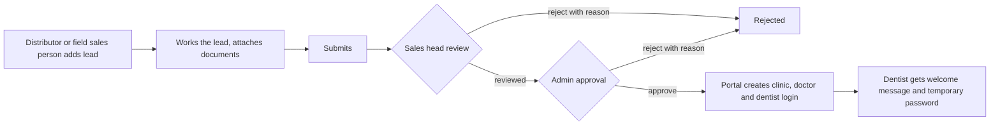
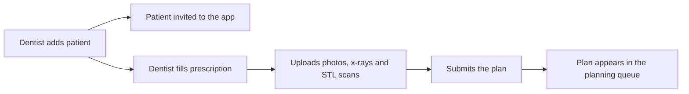
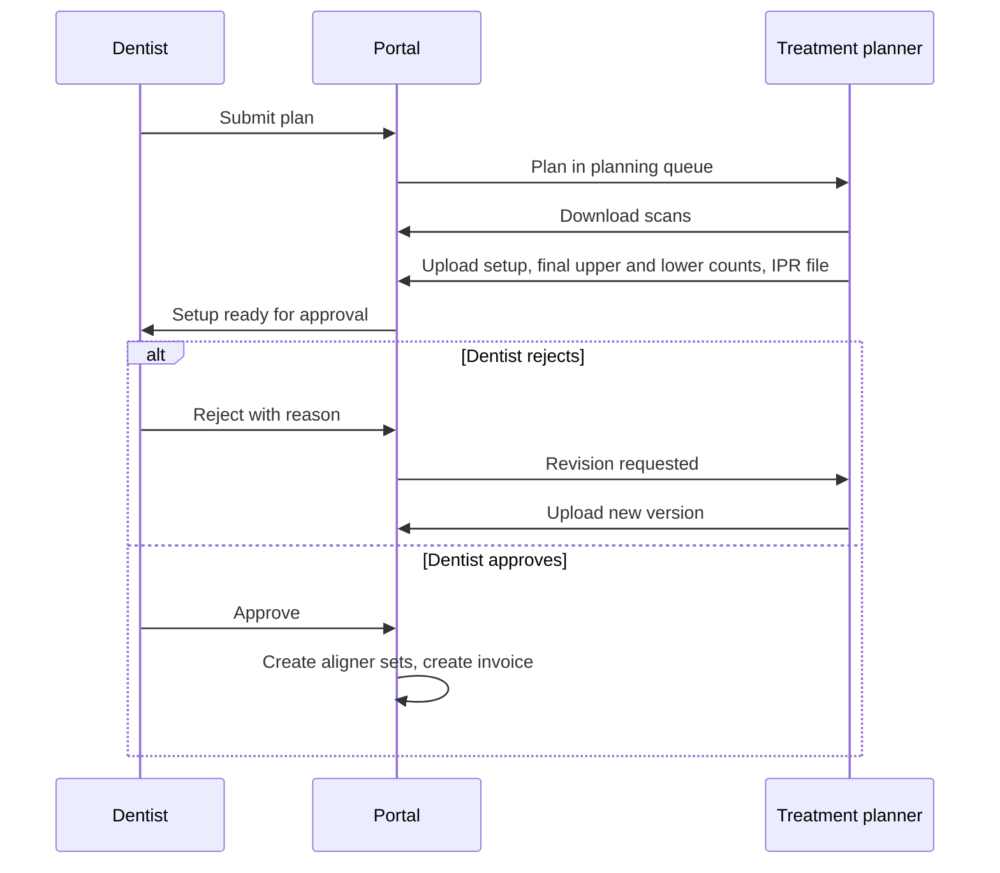
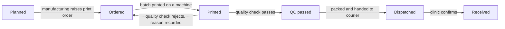
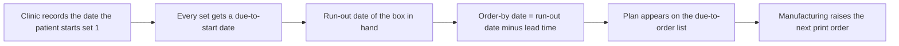
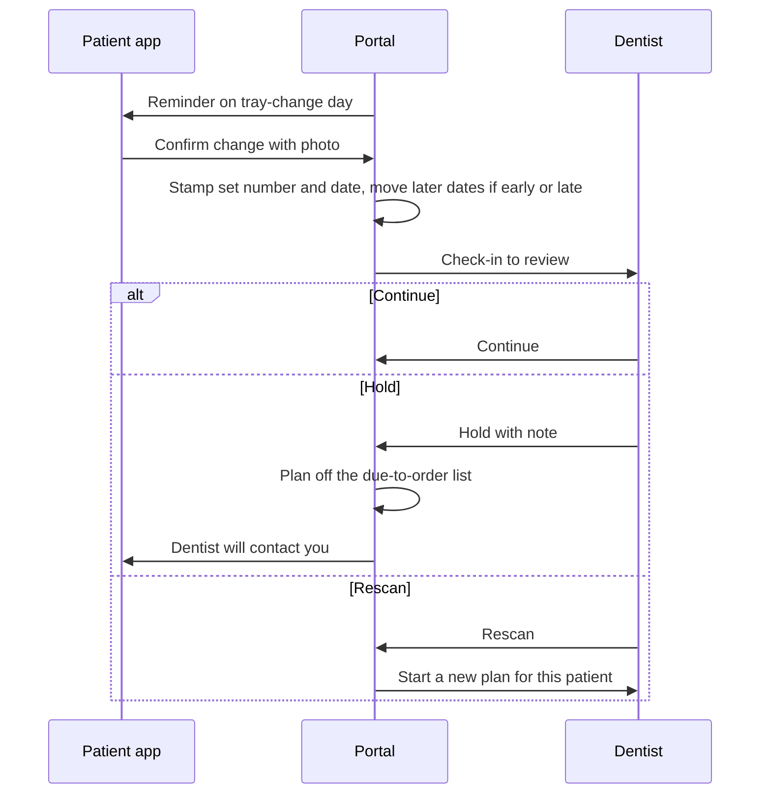
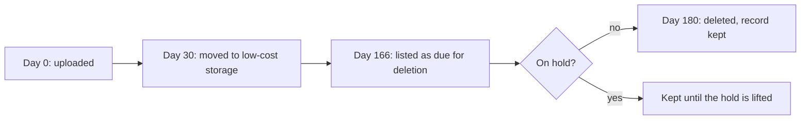

# 06 — Workflows

Each flow names who acts, what the portal does, and what is sent.

## W0 — From a new lead to a won lead

<!--LEADPIPE-->

| Stage | Who moves it | What happens |
|---|---|---|
| New | Portal | The lead arrives from an ad platform, a form, re-engagement, a file or by hand. A repeat enquiry is merged into the existing lead |
| Qualified | LumenAI | LumenAI calls or messages the lead and returns a score and an outcome |
| Contacted | BDE | The BDE calls from the lead screen, records the outcome and sets a follow-up |
| With sales | BDE | The lead is handed to field sales or direct sales with its history |
| Won | Field or direct sales | Visits are logged. The lead agrees to come on board |
| Lost | Anyone working it | With a reason. Can be re-opened, for example by a re-engagement campaign |

1. New leads are assigned by the rule in force: by territory, in rotation, or by hand.
2. Calls and WhatsApp conversations, whether made by a person or by LumenAI, appear on the lead as activities.
3. A lead marked "do not contact" is skipped by every channel.
4. Direct sales can group several leads and clinics under one account.
5. A distributor can add a lead for a dentist or clinic in its own territory. It enters at Contacted and belongs to that distributor.

## W1 — Onboarding a dentist, clinic or distributor

1. Onboarding starts from a won lead. A distributor's lead is always filed under that distributor; any other lead is direct unless a distributor is chosen.
2. The Sales head sees all submitted leads and marks each as reviewed or rejects it.
3. Admin sees reviewed leads and approves or rejects.
4. On approval of a dentist or clinic lead the portal creates the clinic (linked to the distributor, or direct), the doctor, and the dentist's login. On approval of a distributor lead it creates the distributor account and its first login. The default supply type, Branded or White label, is set on the new clinic or distributor at this step. If any step fails, the earlier ones are undone and the lead stays at `reviewed`.
5. The lead owner is told the outcome.

Rule: nobody approves their own lead. A user with both roles' permissions cannot review and approve the same lead.

## W2 — Adding a patient and sending a case

1. The dentist picks the clinic from their own clinics. The doctor is the signed-in dentist.
2. If the patient is under 18, guardian name and mobile are required and the app invite goes to the guardian.
3. The patient is invited to the app straight away. **Settled.**
4. The prescription needs product, supply type, expected upper count and expected lower count. Supply type is Branded or White label; it starts from the clinic's default and the dentist can change it.
5. The plan can be submitted when the nine photo slots and the upper and lower scans are present, or when the dentist ticks "records to follow" (**assumed**: allowed, and the plan is flagged in the planning queue).

## W3 — Treatment planning and approval

1. Each upload is a new version. Old versions stay visible.
2. Only the treating dentist can approve.
3. On approval, final counts and the supply type are fixed on the plan; production creates one set row per number per arch, plus the retainer if included, all `planned`; billing creates the invoice; and the manufacturing team and the dentist are notified.

## W4 — Print, check and dispatch

1. The manufacturing team works from two lists: **new plans** (approved, nothing ordered yet) and **due to order** (W5).
2. A print order names the plan, the arches and the set range. **Only the manufacturing team raises orders. Settled.**
3. A batch records the machine, the operator, the model count and the materials used. Stock is reduced.
4. Quality check passes or rejects per set. A rejected set returns to `ordered` with a reason; that is a reprint and is counted.
5. Dispatch picks `qc_passed` sets for a plan, records courier and tracking, and prints a box label with patient code, clinic and set range. The label carries the patient code, not the patient's phone number. A white-label box goes in plain packaging with a plain label that has no AVMAligners name.
6. The clinic confirms receipt.

## W5 — The dispatch clock and the next box

Rules:

| Rule | Definition |
|---|---|
| Due-to-start date | Start date + (set number − 1) × days per set |
| Run-out date | Due-to-start date of the last set dispatched + days per set |
| Lead time | Print days + courier days + buffer. One setting, changed by Super Admin |
| Order-by date | Run-out date − lead time |
| Box size | Sets per box, per plan, set by the manufacturing team |
| Early or late change | A confirmed tray change sets the real start date of that set; every later date moves by the difference |
| Hold | A doctor's hold removes the plan from the due-to-order list until cleared |
| Last box | Includes the retainer where the plan has one |

If the start date has not been recorded seven days after a box is received, the clinic is reminded (**assumed** threshold).

## W6 — Tray change and doctor check (patient app)

1. The schedule does not wait for the doctor. If the dentist does nothing, treatment continues on plan. A hold is a deliberate act.
2. Wear time is optional and for information.
3. If a change is not confirmed three days after it is due, the patient is reminded once more, then the dentist is told (**assumed** thresholds).

## W7 — Refinement and rescan

1. The dentist starts a new plan for the same patient, type `refinement` or `rescan`, with new scans.
2. It goes through W3.
3. When the new plan is approved, the old plan becomes `superseded`. Its `planned` and `ordered` sets are closed as `superseded`. Sets already printed or dispatched are untouched.
4. Numbering on the new plan starts at 1.
5. Billing for a refinement: **open** — free within the product, or charged. Until decided, the invoice is created at zero value and flagged for Accounts.

## W8 — STL scan life

The move and the deletion are storage rules. The portal only records and reports them.

## W9 — Invoice and payment

1. Plan approved → invoice created. Customer is the distributor if the clinic belongs to one, otherwise the clinic. **Settled.**
2. Price comes from the price list that applies on the approval date, branded or white label as the plan says.
3. Accounts records each payment. The invoice moves from `unpaid` to `part_paid` to `paid`.
4. A wrong invoice is cancelled with a reason and a new one raised. Invoices are never edited or deleted.
5. Direct dentists and distributors see their own invoices. Distributor dentists see none.

Whether production waits for payment: **open**. As written, production does not wait.

## W10 — Stock and machines

1. Stock in: Production records a receipt against an item with the supplier reference.
2. Stock out: recorded automatically from the materials entered on a print batch; wastage and adjustments are entered by hand with a note.
3. An item at or below its reorder level appears on the low-stock list and Production is notified once.
4. A machine going down is recorded with a start time and reason; closing the record brings it back to `running`. Batches cannot be recorded on a machine marked `down`.

## W11 — Access changes

1. Admin creates a staff user and gives the temporary password in person or by a separate channel.
2. A user who leaves is disabled, not deleted. Their records and audit history stay.
3. Role changes sign the user out.
4. A dentist who moves between distributors or goes direct: Admin changes the clinic's `distributorId`. Existing invoices stay with the old customer; new plans bill the new one.

<!--EXT2-->
## Workflows added in version 2.0

### W12 — Online payment

1. The customer picks invoices and pays on the payment partner's page.
2. The partner sends a signed event. The portal verifies it, records the payment and matches it to the invoices.
3. The invoice status changes and the receipt is sent. An unmatched payment waits on the Online payments screen.

### W13 — Credit hold

1. Accounts sets a limit and credit days for each customer.
2. Reminders go out before and after the due date by the reminder schedule.
3. When the rule is crossed the account is put on hold. A dentist of that account can still submit a plan, but the setup cannot be approved.
4. Admin can release the hold with a reason. Payment clears it automatically.

### W14 — Lost or broken aligner

1. The patient reports the problem in the app and is told to wear the previous tray.
2. The treating dentist decides: continue to the next set, go back a set, or replace.
3. Replace raises one print order for that tray. The schedule moves by the days lost.
4. The replacement is dispatched as a shipment linked to the original box. Any charge follows the price list and is raised to the customer, never shown to the patient.

### W15 — Support ticket and complaint

1. A ticket arrives from the portal, the app, WhatsApp, email or a call.
2. It gets a type, an owner team and a deadline from the rules.
3. A complaint about a product is linked to the plan, the dispatch and the batch, and opens a non-conformance record.
4. The ticket closes when the user confirms, and a satisfaction score is asked.

### W16 — Partner brand goes live

1. The partner fills its brand profile and uploads artwork.
2. Each artwork is proofed. Both sides approve; the company's approver confirms the regulatory lines are present.
3. Admin approves the profile. From then, the app, messages, portal and documents for that partner's clinics use its brand.
4. The partner's packaging is printed, received into its packaging stock and used on its dispatches.

### W17 — Courier booking to proof of delivery

1. Every tray is scanned into the box; a photo is taken; the box is closed.
2. The portal lists couriers that serve the PIN code and picks by the rule in force.
3. Booking returns the waybill and label. The manifest is signed at pick-up.
4. Tracking events update the dispatch. Delivery stores proof of delivery. A box at risk against the run-out date is flagged.

### W18 — Traceability and recall

1. Each model and tray carries a barcode and is scanned at every station.
2. Each material issue records the lot.
3. To recall, the Production head picks a lot. The portal lists every set, patient code, clinic and where each set is now.
4. Starting a recall opens tickets to the clinics, holds sets on the shelf and records the outcome for each.

### W19 — Non-conformance and corrective action

1. A record opens from a QC trend, a pack audit, a complaint or an audit.
2. An owner records the cause and the corrective action with a due date.
3. After the action, the effect is checked. Only then can the record be closed.

### W20 — Conversions feedback and audiences

1. A lead arrives with its tracking and consent.
2. As the lead becomes qualified, won and onboarded, the portal sends each event to the ad platform it came from.
3. Each night audiences are rebuilt from lead stages and synced. Onboarded and do-not-contact contacts are always excluded.

### W21 — Proposal, price approval and agreement

1. Sales builds a proposal from the price list.
2. A discount within the user's limit can be sent. Above it, the request goes to the Sales head or Admin.
3. On acceptance the agreement is sent for signature on screen.
4. The signed agreement is stored on the account and unlocks onboarding approval.

### W22 — Suitability check to case

1. The dentist sends a few photos and a question.
2. A planner answers within a working day with a grade and an estimate of sets.
3. If suitable, the dentist starts the case from the answer; the photos carry over.

### W23 — Purchase to stock

1. A low-stock item or a partner packaging reorder raises a requisition.
2. The Purchase officer raises a purchase order to a supplier.
3. On delivery, a goods receipt creates the material lot and adds the stock.
4. The supplier's on-time and reject record updates its rating.
<!--EXT2-->

## Notification events

| Event | To | WhatsApp | Email | App |
|---|---|---|---|---|
| New lead assigned | BDE or sales owner | | ● | |
| Follow-up due or missed | Lead owner | | ● | |
| Lead handed over | Field or direct sales | | ● | |
| Lead submitted | Sales head | | ● | |
| Lead reviewed | Admin | | ● | |
| Lead approved or rejected | Lead owner | ● | ● | |
| Welcome and login | Dentist | ● | ● | |
| Patient added | Patient or guardian | ● | | |
| Plan submitted | Treatment planner | | ● | |
| Setup ready | Dentist | ● | ● | |
| Setup rejected | Treatment planner | | ● | |
| Plan approved | Manufacturing team, Accounts | | ● | |
| Plan due to order | Manufacturing team | | ● | |
| Box dispatched | Dentist, patient | ● | ● | ● |
| Box received | Manufacturing team | | ● | |
| Start date missing | Clinic | ● | | |
| Tray change due | Patient | | | ● |
| Tray change missed | Patient, then dentist | ● | | ● |
| Check-in to review | Dentist | | ● | |
| Hold or rescan decided | Patient, manufacturing team | ● | ● | ● |
| Scan due for deletion | Dentist, treatment planner | | ● | |
| Low stock | Production | | ● | |
| Invoice raised | Distributor or direct clinic | | ● | |
| Payment recorded | Distributor or direct clinic | | ● | |

Dots are the default. Admin can switch any of them off.
